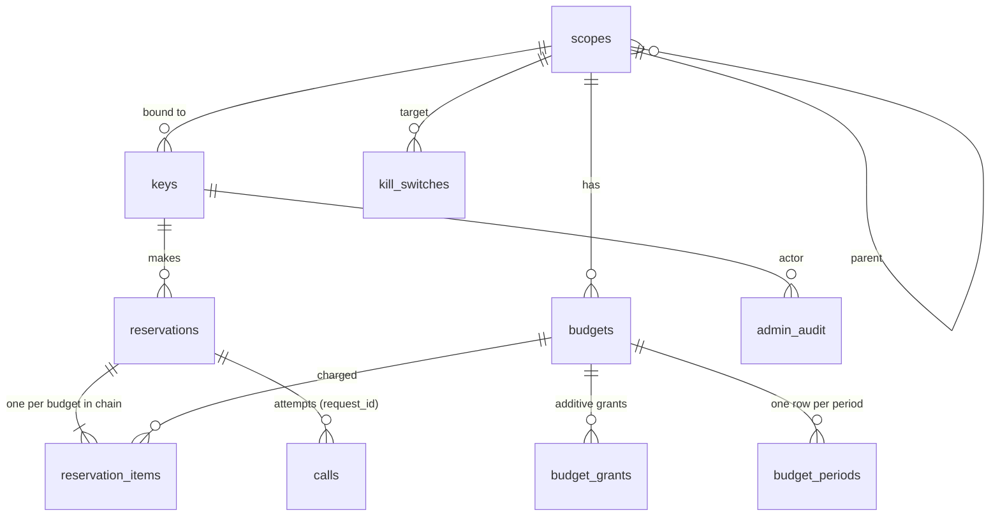

# spendgate data model

Status: implemented in v0.1. Companion: [ledger-state-machine.md](ledger-state-machine.md).

## Additions to the glossary tables (justified)

| Added | Why |
|---|---|
| `budget_periods` | Per-period `spent`/`held` live here, not on `budgets` (see Periods). |
| `reservation_items` | One row per (reservation, budget in the chain): the "amounts per budget" of a reservation. A single column cannot hold a chain. |
| `budget_grants` | Additive temporary room: effective cap = `cap_nano` + sum of active grants. Replaces the old validity window on `budgets`. |
| `ledger_meta` | Key/value row `currency`: the ledger currency, written on first open. Opening the ledger with another currency is refused at start (mixed currencies would make every cap meaningless). |
| `instances` is **not** added | Liveness is the lease expiry alone; the heartbeat renews by `reservations.owner_instance`. A heartbeat table would be a second source of truth about who is alive. |

## Conventions (both dialects)

- **Money:** `BIGINT` integer **nano**-units of the ledger currency (1 EUR = 10^9); every money field ends in `_nano` and is non-negative (CHECK). Ceiling rounding in `core`, never in SQL. Max 9.2e9 EUR per cell. No floats, no `NUMERIC`, no `REAL` anywhere. FX is an integer: `fx_rate_nano` = ledger units per 1 native unit x 10^9, from the `fx` config (required when a catalog currency differs from the ledger currency; in library mode the ledger currency follows the cap's currency).
- **Time:** `BIGINT` UTC epoch milliseconds, supplied by the application (`now` is a parameter from the injected application clock; SQL never calls `now()`; `/readyz` warns on skew against the database clock). Period starts are UTC midnight (day) or first of the month midnight (month) in epoch ms; `0` for period `none`.
- **Ids:** `TEXT`, ULID or UUIDv7, lowercase. Lock ordering sorts ids **in the application** (plain string sort), so DB collation is irrelevant. `reservations.id` is the request id; a hold on an existing id is a `conflict`, never an idempotent replay.
- **Booleans:** nullable timestamp (`revoked_at`) or `INTEGER` 0/1 with `CHECK`. **JSON:** `TEXT`, validated by the application (PostgreSQL migration may use `JSONB` later without changing queries).
- **Hierarchy:** org > project > service > user > session, validated in the application (parent kind rank); depth <= 5, walked with `WITH RECURSIVE` (both dialects).

## ER diagram



## DDL (SQLite and PostgreSQL, one file)

```sql
CREATE TABLE ledger_meta (
  key   TEXT PRIMARY KEY,                            -- 'currency': the ledger currency, written on first open
  value TEXT NOT NULL
);

CREATE TABLE scopes (
  id               TEXT    PRIMARY KEY,                -- ULID
  kind             TEXT    NOT NULL CHECK (kind IN ('org','project','service','user','session')),
  parent_id        TEXT    REFERENCES scopes(id),
  name             TEXT    NOT NULL,                   -- segment value, e.g. 'api'
  path             TEXT    NOT NULL UNIQUE,            -- human path, e.g. 'org:acme/project:app/service:api'; a session segment is 'session:<key id>:<session id>' and may contain ':' and '#'
  created_at       BIGINT  NOT NULL,
  disabled_at      BIGINT,
  -- session scopes only; copied from keys.session_defaults when the session is created (NULL/0 for other kinds)
  max_steps        BIGINT  CHECK (max_steps IS NULL OR max_steps > 0),
  max_seconds      BIGINT  CHECK (max_seconds IS NULL OR max_seconds > 0),
  idle_seconds     BIGINT  CHECK (idle_seconds IS NULL OR idle_seconds > 0),
  step_count       BIGINT  NOT NULL DEFAULT 0 CHECK (step_count >= 0),
  started_at       BIGINT,
  last_activity_at BIGINT,
  closed_at        BIGINT,
  closed_reason    TEXT    CHECK (closed_reason IS NULL OR closed_reason IN ('steps','time','budget')),  -- why a limit closed it; NULL while open and for an idle restart; set together with closed_at
  display_name     TEXT,                                -- migration 0003 (ADR-0008): free-text label for lists and dashboards; not part of the path, never used in a decision
  CHECK (closed_reason IS NULL OR closed_at IS NOT NULL),
  CHECK ((kind = 'org') = (parent_id IS NULL)),
  CHECK (kind = 'session' OR (max_steps IS NULL AND max_seconds IS NULL AND idle_seconds IS NULL
                              AND started_at IS NULL AND step_count = 0)),
  UNIQUE (parent_id, name)
);

CREATE TABLE keys (
  id             TEXT    PRIMARY KEY,
  prefix         TEXT    NOT NULL UNIQUE,            -- the <prefix> in sg-<prefix>-<secret>
  secret_hash    TEXT    NOT NULL,                   -- hex HMAC-SHA256(key = server pepper, msg = secret); never the secret (the 0001 SQL comment still says SHA-256(secret || pepper); the stored value is the HMAC)
  kind           TEXT    NOT NULL DEFAULT 'api' CHECK (kind IN ('api','admin')),
  scope_id       TEXT    NOT NULL REFERENCES scopes(id),
  name           TEXT    NOT NULL,
  allowed_models TEXT,                               -- JSON array of globs; NULL = all
  limits         TEXT,                               -- JSON: rpm, tpm, max_concurrent, max_output_tokens, per_call_ceiling_nano
  session_defaults TEXT,                             -- JSON: budget_nano, max_steps, max_seconds, idle_seconds, max_new_sessions_per_hour, required (true only when set: calls must name a session); NULL = sessions not allowed
  admin_perms    TEXT,                               -- JSON array of usage:read, keys:write, budgets:write; admin keys only (kind 'admin', format sga-<prefix>-<secret>; scope_id is the org they were created under and does not limit them)
  created_at     BIGINT  NOT NULL,
  expires_at     BIGINT,                             -- rotation sets this on the old key (grace period)
  revoked_at     BIGINT,
  replaces_key_id TEXT   REFERENCES keys(id)
);

CREATE TABLE budgets (
  id                 TEXT    PRIMARY KEY,
  scope_id           TEXT    NOT NULL REFERENCES scopes(id),
  period             TEXT    NOT NULL CHECK (period IN ('none','day','month')),   -- UTC
  cap_nano           BIGINT  NOT NULL CHECK (cap_nano >= 0),
  soft_pct           INTEGER NOT NULL DEFAULT 80 CHECK (soft_pct BETWEEN 1 AND 99),
  model_filter       TEXT,                           -- glob; NULL = every model
  strict_overrun     INTEGER NOT NULL DEFAULT 1 CHECK (strict_overrun IN (0,1)),
  review_required_at BIGINT,                         -- set when a breach overrun happened; cleared only by ack-overrun
  note               TEXT,                           -- free text from the admin API (max 500)
  created_at         BIGINT  NOT NULL,
  disabled_at        BIGINT
);
-- Additive grants: effective cap = cap_nano + SUM(amount_nano) of grants with valid_from <= now < valid_until.
CREATE TABLE budget_grants (
  id           TEXT   PRIMARY KEY,
  budget_id    TEXT   NOT NULL REFERENCES budgets(id),
  amount_nano  BIGINT NOT NULL CHECK (amount_nano > 0),
  valid_from   BIGINT NOT NULL,
  valid_until  BIGINT NOT NULL,
  created_by   TEXT   NOT NULL,
  created_at   BIGINT NOT NULL,
  reason       TEXT   NOT NULL,
  CHECK (valid_until > valid_from)
);
CREATE INDEX budget_grants_budget ON budget_grants(budget_id, valid_until);
CREATE INDEX budgets_scope ON budgets(scope_id) WHERE disabled_at IS NULL;

-- Money state. One row per budget and period start; every access happens under that budget's row lock.
CREATE TABLE budget_periods (
  budget_id    TEXT   NOT NULL REFERENCES budgets(id),
  period_start BIGINT NOT NULL,                      -- epoch ms UTC; 0 for period 'none'
  spent_nano   BIGINT NOT NULL DEFAULT 0 CHECK (spent_nano >= 0),
  held_nano    BIGINT NOT NULL DEFAULT 0 CHECK (held_nano >= 0),
  overrun_nano BIGINT NOT NULL DEFAULT 0 CHECK (overrun_nano >= 0),  -- sum of (charge - hold) over overrunning calls
  excess_nano  BIGINT NOT NULL DEFAULT 0 CHECK (excess_nano >= 0),   -- spent+held above the effective cap, recorded when a cap is lowered or a grant expires
  calls_count  BIGINT NOT NULL DEFAULT 0 CHECK (calls_count >= 0),
  soft_alerted_at BIGINT,
  PRIMARY KEY (budget_id, period_start)
);

CREATE TABLE reservations (
  id               TEXT   PRIMARY KEY,               -- request id, unique for the retention window
  state            TEXT   NOT NULL CHECK (state IN ('pending','settled','released','expired')),   -- reservation states, not call outcomes
  owner_instance   TEXT   NOT NULL,
  lease_expires_at BIGINT NOT NULL,
  key_id           TEXT   NOT NULL REFERENCES keys(id),
  scope_id         TEXT   NOT NULL REFERENCES scopes(id),   -- leaf scope of the chain
  session_id       TEXT   REFERENCES scopes(id),            -- counted step, if any
  outcome          TEXT   CHECK (outcome IS NULL OR outcome IN ('ok','ok_no_usage','client_error','throttled',
                     'timeout','upstream_5xx','unreachable','cancelled','stream_broken','internal_error','expired')),
  charged_nano     BIGINT CHECK (charged_nano IS NULL OR charged_nano >= 0),
  meta             TEXT   NOT NULL,                         -- JSON written at hold time: endpoint, model, candidates (provider, deployment, price_id, fx), catalog_sha, labels; lets the sweeper write a complete calls row
  created_at       BIGINT NOT NULL,
  finished_at      BIGINT,
  CHECK ((state = 'pending') = (finished_at IS NULL))
);
CREATE INDEX reservations_lease ON reservations(lease_expires_at) WHERE state = 'pending';
CREATE INDEX reservations_owner ON reservations(owner_instance)   WHERE state = 'pending';

CREATE TABLE reservation_items (
  reservation_id TEXT   NOT NULL REFERENCES reservations(id),
  budget_id      TEXT   NOT NULL REFERENCES budgets(id),
  period_start   BIGINT NOT NULL,                    -- the period in which the hold was made; settlement goes here
  held_nano      BIGINT NOT NULL CHECK (held_nano >= 0),
  overrun_nano   BIGINT NOT NULL DEFAULT 0 CHECK (overrun_nano >= 0),
  PRIMARY KEY (reservation_id, budget_id)
);

-- One row per provider attempt; a request failed over to another deployment of the same catalog id has attempts 1..n
-- under ONE reservation. Refused requests write no row. A late settle after expiry UPDATEs the sweeper's row.
CREATE TABLE calls (
  request_id          TEXT   NOT NULL,
  attempt             INTEGER NOT NULL DEFAULT 1 CHECK (attempt >= 1),
  key_id              TEXT   NOT NULL,
  scope_id            TEXT   NOT NULL,
  session_id          TEXT,
  user_label          TEXT,                          -- X-Spendgate-User or fallback; attribution only
  labels              TEXT,                          -- JSON object, tags for usage grouping
  endpoint            TEXT   NOT NULL,               -- e.g. /v1/chat/completions
  provider            TEXT   NOT NULL,               -- slug = module name
  deployment          TEXT   NOT NULL,
  model               TEXT   NOT NULL,               -- catalog id
  price_id            TEXT   NOT NULL,               -- catalog entry id + effective_from used
  catalog_sha         TEXT   NOT NULL,               -- sha256 of the catalog files loaded
  tokens_in           BIGINT NOT NULL DEFAULT 0 CHECK (tokens_in >= 0),
  tokens_out          BIGINT NOT NULL DEFAULT 0 CHECK (tokens_out >= 0),
  tokens_cached       BIGINT NOT NULL DEFAULT 0 CHECK (tokens_cached >= 0),
  tokens_cache_write  BIGINT NOT NULL DEFAULT 0 CHECK (tokens_cache_write >= 0),
  tokens_reasoning    BIGINT NOT NULL DEFAULT 0 CHECK (tokens_reasoning >= 0),
  audio_tokens_in     BIGINT NOT NULL DEFAULT 0 CHECK (audio_tokens_in >= 0),
  audio_tokens_out    BIGINT NOT NULL DEFAULT 0 CHECK (audio_tokens_out >= 0),
  audio_ms            BIGINT NOT NULL DEFAULT 0 CHECK (audio_ms >= 0),
  characters          BIGINT NOT NULL DEFAULT 0 CHECK (characters >= 0),
  images              BIGINT NOT NULL DEFAULT 0 CHECK (images >= 0),
  native_currency     TEXT   NOT NULL,
  native_cost_nano    BIGINT NOT NULL DEFAULT 0 CHECK (native_cost_nano >= 0),   -- native currency nano-units
  fx_rate_nano        BIGINT NOT NULL CHECK (fx_rate_nano > 0),                  -- ledger per native x 1e9; 1000000000 when currencies match
  charged_nano        BIGINT NOT NULL DEFAULT 0 CHECK (charged_nano >= 0),       -- ledger currency: money booked to the budgets for this attempt (0 if not_processed, full hold for cancel/5xx after send or sweeper expiry); sums to the settle charge
  usage_cost_nano     BIGINT CHECK (usage_cost_nano IS NULL OR usage_cost_nano >= 0),  -- ledger currency, ceiling, computed from reported usage; NULL when no usage was seen
  hold_nano           BIGINT NOT NULL DEFAULT 0 CHECK (hold_nano >= 0),
  overrun_nano        BIGINT NOT NULL DEFAULT 0 CHECK (overrun_nano >= 0),
  http_status         INTEGER CHECK (http_status IS NULL OR http_status BETWEEN 100 AND 599),  -- the provider's HTTP status for this attempt; NULL when it never answered (ADR-0010)
  outcome             TEXT   NOT NULL CHECK (outcome IN ('ok','ok_no_usage','client_error','throttled',
                        'timeout','upstream_5xx','unreachable','cancelled','stream_broken','internal_error','expired')),
  error_code          TEXT,                          -- a documented code (see `calls.error_code` values); NULL when none applies
  streamed            INTEGER NOT NULL DEFAULT 0 CHECK (streamed IN (0,1)),
  settled_by          TEXT   NOT NULL DEFAULT 'owner' CHECK (settled_by IN ('owner','sweeper')),
  review_required_at  BIGINT,                        -- set by the C-22 usage sanity flag (the usage is still booked in full)
  started_at          BIGINT NOT NULL,
  finished_at         BIGINT NOT NULL,
  latency_ms          BIGINT,
  ttfb_ms             BIGINT,
  PRIMARY KEY (request_id, attempt)
);
CREATE INDEX calls_finished     ON calls(finished_at);
CREATE INDEX calls_key_finished ON calls(key_id, finished_at);
CREATE INDEX calls_model_finished ON calls(model, finished_at);

CREATE TABLE kill_switches (
  id          TEXT   PRIMARY KEY,
  target_kind TEXT   NOT NULL CHECK (target_kind IN ('global','scope','key','provider','model')),
  target_ref  TEXT   NOT NULL DEFAULT '',            -- '' for global; scope ULID, key id, provider slug, catalog model id
  reason      TEXT   NOT NULL,
  created_by  TEXT   NOT NULL,
  created_at  BIGINT NOT NULL,
  cleared_at  BIGINT,
  CHECK ((target_kind = 'global') = (target_ref = ''))
);
CREATE INDEX kill_active ON kill_switches(target_kind, target_ref) WHERE cleared_at IS NULL;

-- Append-only, protected by triggers (no hash chain, no advisory lock). Rows are written in the same transaction as the change.
CREATE TABLE admin_audit (
  id          TEXT   PRIMARY KEY,                    -- ULID
  at          BIGINT NOT NULL,
  actor_key_id TEXT  NOT NULL,
  action      TEXT   NOT NULL,                       -- budget.set_cap, budget.grant, key.revoke, overrun.ack, kill.set ...
  target_type TEXT   NOT NULL,
  target_id   TEXT   NOT NULL,
  request_id  TEXT,                                  -- admin request id
  before      TEXT,                                  -- JSON, NULL for creates
  after       TEXT                                   -- JSON, NULL for deletes
);
CREATE TRIGGER admin_audit_no_update BEFORE UPDATE ON admin_audit
BEGIN SELECT RAISE(ABORT, 'admin_audit is append-only'); END;
CREATE TRIGGER admin_audit_no_delete BEFORE DELETE ON admin_audit
BEGIN SELECT RAISE(ABORT, 'admin_audit is append-only'); END;
```

## `calls.error_code` values

What went wrong with one attempt, as a stable code ([ADR-0022](adr/0022-stable-error-codes.md)). The pipeline writes only the values
below: the field is typed with the enums in `core.failures`, so anything else fails `mypy --strict`,
and `tests/docs/test_error_code_docs.py` keeps this list and the enums in step. NULL when nothing
went wrong (`ok`, `ok_no_usage`), for a non-2xx answer the adapter did not classify (a redirect)
and for sweeper rows (`expired`).

A provider's error answer records the protocol code it maps to (protocol.md section 4.2, e.g.
`upstream_throttled`, `upstream_unavailable`, `invalid_request`). An attempt the gateway ended
while it was in flight records its outcome (`cancelled`, `timeout` for the request deadline,
`internal_error`). Read `error_code` together with `outcome`: the same value can appear under
different outcomes (`internal_error` is both a protocol code and an outcome), and the outcome, not
the code, decides the charge. Every other value is one of these:

| Value | Written when | Sent? |
|---|---|---|
| `connect_error` | the connection could not be opened (refused, DNS, TLS handshake) | no |
| `connect_timeout` | opening the connection timed out | no |
| `pool_timeout` | no pooled connection became free in time | no |
| `proxy_error` | the outbound proxy tunnel failed | no |
| `unsupported_protocol` | the deployment URL has a scheme the client cannot open | no |
| `write_error` | writing the request failed part way | yes |
| `write_timeout` | writing the request timed out | yes |
| `read_error` | reading the answer failed (a buffered body, or a stream mid-body) | yes |
| `read_timeout` | no answer, or no next chunk, in time | yes |
| `close_error` | closing the connection failed | yes |
| `remote_protocol_error` | the provider broke the HTTP protocol | yes |
| `local_protocol_error` | the client broke the HTTP protocol | yes |
| `decoding_error` | the answer's content encoding could not be decoded | yes |
| `too_many_redirects` | the provider redirected too often | yes |
| `transport_error` | any other HTTP client error | yes |
| `unexpected_error` | an exception that is not an HTTP client error, while sending or reading | yes |
| `response_too_large` | a buffered answer was larger than its cap (64 MiB; 1 MiB for an error answer to a streaming request) | yes |
| `stream_malformed` | a stream had bad framing, a bad checksum or encoding, or ended inside an event | yes |
| `stream_limit_exceeded` | a stream crossed an SSE line, event, count, size or frame limit (C-22) | yes |
| `relay_error` | the stream relay could not be created or raised while relaying | yes |
| `adapter_error` | the adapter raised while reading a sent request's answer or error | yes |
| `lease_expiring` | the gateway stopped a stream whose lease was within one heartbeat of expiry | yes |
| `lease_lost` | the gateway stopped a stream the renewal did not return (a sweeper expired it) | yes |
| `renewal_failed` | the gateway stopped a stream because the lease renewal failed | yes |
| `max_duration` | the gateway stopped a stream that ran past `server.max_request_seconds` | yes |
| `kill_switch` | the gateway stopped a stream because a kill switch now matches it | yes |
| `session_time` | the gateway stopped a stream because its session's `max_seconds` passed | yes |
| `client_gone` | the client disconnected or closed the stream early (`cancelled`) | yes |

"Sent? no" attempts are `not_processed` (free, failed over); the others are charged by their
outcome (ledger-state-machine.md). Codes are only added, never renamed; a new one needs a row here.

**Legacy values.** Rows written by earlier releases keep what was stored then: the exception class name
instead of the codes above, e.g. `ConnectError`, `ConnectTimeout`, `PoolTimeout`, `ProxyError`,
`UnsupportedProtocol`, `WriteError`, `WriteTimeout`, `ReadError`, `ReadTimeout`, `CloseError`,
`RemoteProtocolError`, `LocalProtocolError`, `DecodingError`, `TooManyRedirects`,
`ResponseTooLarge`, `StreamBroken`, `StreamLimitExceeded`, `EventStreamError`, `FrameTooLarge`
(or another exception class name). They are not rewritten; a query over a mixed window should
match both spellings.

## Dialect differences

| Topic | SQLite | PostgreSQL |
|---|---|---|
| Write serialisation | `BEGIN IMMEDIATE` (one writer, WAL) | `BEGIN` + one `SELECT ... FOR UPDATE` per budget row in ascending id order, READ COMMITTED |
| Foreign keys | `PRAGMA foreign_keys=ON` per connection | always on |
| `BIGINT` | alias of 64-bit `INTEGER` | `int8` |
| Audit immutability | the two triggers in the DDL (`RAISE(ABORT)`) | equivalent `BEFORE UPDATE OR DELETE` trigger raising an exception, plus `REVOKE UPDATE, DELETE` for the app role (migration file) |
| Sweeper election | any process, the state guard makes it safe | optional `pg_try_advisory_lock` (efficiency only, correctness is the state guard) |
| Deadlocks | none (single writer) | retry the transaction, at most 3 times |
| JSON columns | `TEXT` | `TEXT` now, `JSONB` possible later |
| Upsert, `RETURNING`, partial indexes, `WITH RECURSIVE` | supported (SQLite >= 3.35) | supported |

## Periods: how per-period spent is stored

Chosen: **one `budget_periods` row per (budget, period start)**, created lazily by `INSERT ... ON CONFLICT DO NOTHING` under the budget row lock.

| Option | Verdict |
|---|---|
| `spent` on the `budgets` row, reset by a job at midnight | Rejected: a missed or late job corrupts money; a rollover with holds in flight needs special cases; no history. |
| Derive spent from `SUM(calls)` per period | Rejected: slow on the admission path, breaks when `calls` is folded by retention, cannot include holds. |
| `budget_periods` row (chosen) | Rollover is implicit: a new period start is a new row that begins at zero. A hold is bound to its `period_start`, so a call that straddles midnight settles into the period it was admitted in. Period history is free and survives retention. Cap changes are one `UPDATE` on `budgets`. |

`period = 'none'` uses `period_start = 0` (lifetime budget). Temporary extra room is a **grant** (`budget_grants`), additive to `cap_nano`: `effective_cap = cap_nano + SUM(amount_nano)` over grants active at `now` (`valid_from <= now < valid_until`). Different budgets (scope, period, filter) all apply; every budget in the chain must pass. Expiry is time-driven; the lost room is recorded as `excess_nano` lazily, under the budget lock, at the next admission or sweep (rules: [ledger-state-machine.md](ledger-state-machine.md)).

## Sessions

A session is a child scope created on first use under the key's scope, only for keys with `session_defaults`; the limits are copied onto the row. Sessions are **per key**: the segment value is `<key id>:<session id>`, so two keys on one scope never share a session; that is why the segment allows `:`. **Restart rule:** after idle expiry (and only then) the old row is closed (`closed_at = now`) and renamed (`name` and `path` get the suffix `#<started_at>`, hence `#`), and a new row with the original name is created, so `UNIQUE (parent_id, name)` and `UNIQUE (path)` never block it and the step counter restarts. A session that hit any limit (budget, steps, seconds) is closed without a restart (`closed_at` plus `closed_reason` = `steps`, `time` or `budget`, written together): the same id keeps getting `session_limit_reached`, and `details.limit` is the stored reason. The ledger writes the close when it refuses a call for a limit; a steps or budget refusal while another reservation of that session is still pending does not close it yet (a final `release` of that reservation refunds its step and its hold, scenario 9). An idle restart sets `closed_at` only. `session_defaults.budget_nano` becomes a `budgets` row (period `none`) on the new session scope. `max_new_sessions_per_hour` counts session rows created **by that key** (key id in the session segment) in the last hour, renamed ones included.

## Retention

- `calls` older than `retention_days` (default 90, configurable) are deleted by the retention job (run by `serve` once a day, and on its first pass; the sweeper runs every `ledger.sweep_seconds`, default 30), whole UTC days only. There is **no `daily_usage` rollup in v0.1** (Size decision; the table is not in the DDL; the fold is on the roadmap). Usage queries therefore cover the retention window only.
- Terminal `reservations` (and items) older than the same window are deleted; pending ones never. This bounds how long a request id stays unique: one reused after retention is treated as new.
- Closed sessions (`closed_at` older than the same window, renamed or explicitly closed) are deleted with their session budgets and periods, after their reservations; open sessions never.
- **How it runs.** `delete_calls_older_than(days, now)` computes the boundary, the UTC midnight at or before `now - days`, so a day is kept or deleted whole. It records the boundary in `ledger_meta` (key `retention_boundary`, only ever raised) **before** deleting, then removes `calls`, terminal `reservations` (items first) and closed sessions in bounded batches, one transaction per batch (default 1000 rows), so writers are never blocked for long. A session with a pending hold is skipped until the hold ends. A rare straggler call written by the sweeper after its session closed stays until its own day expires. Re-running is a no-op.
- **Usage covers the retention window only.** `usage` refuses a `since` older than the boundary (the stored one, or the one a passed `retention_days` implies) with `UsageRangeError`, which the admin API maps to `invalid_request` with param `since`; an absent `since` is clamped to the boundary and the effective value is returned.
- **Usage counting rules.** `calls` counts attempt rows (a failover is two). `day` buckets UTC midnights from `finished_at`. Dimensions are a fixed whitelist of column expressions: `scope`, `project`, `service`, `session` (paths; `''` when absent or deleted), `user` (`user_label`), `key`, `model`, `provider`, `deployment`, `outcome`, `tag`, `day`; at most 6 per query. `tag` is multi-valued: a call counts once under each `name=value` label and once under `''` when it has none, so rows grouped by tag overlap and the result's `total` (computed without the expansion, `tags_overlap = true`) is the true figure. `usage` basis sums `usage_cost_nano` and treats NULL (no reported usage) as 0, a lower bound; `charged` sums booked money and equals the ledger's spent for the same window.
- `budget_periods` (except those of deleted closed sessions), `budget_grants`, `admin_audit`, `kill_switches` are never deleted (small, and audit must stay). Usage queries read `calls` only and default to `charged_nano` (money booked); `usage_cost_nano` is available as the usage basis.

## Indexes summary

`reservations(lease_expires_at) WHERE pending` (sweeper), `reservations(owner_instance) WHERE pending` (heartbeat `renew_all`), `calls(finished_at)` (usage window and retention), `calls(key_id, finished_at)`, `calls(model, finished_at)`, `reservations(finished_at) WHERE state <> 'pending'` and `reservations(session_id)` (retention, migration 0002), `scopes(closed_at) WHERE closed_at IS NOT NULL` (retention, 0002), `budgets(scope_id)`, `budget_grants(budget_id, valid_until)`, `keys(prefix)` unique, `scopes(path)` unique, `kill_switches(target_kind,target_ref) WHERE active`.

## Open points

- **O1** closed: grants are additive; the old override rule is gone.
- **O2** `calls` has no FK to `reservations` on purpose (they are retained and folded independently).
