# spendgate ledger state machine

Status: implemented in v0.1. Tables: [data-model.md](data-model.md). All money below is shown in EUR; stored as integer nano-units. `S` = spent, `H` = held, `cap`, `eff` = effective cap, `ovr` = `overrun_nano`, `exc` = `excess_nano` (all per `budget_periods` row).

## Invariant

For every `budget_periods` row, at every committed instant (after the lazy normalisation below):

> **I1:** `S + H <= eff + ovr + exc`, where `eff = cap_nano + SUM(active grants)`      **I2:** `S >= 0, H >= 0` (table CHECKs)

Why it holds: admission only inserts a hold when `S + H + worst <= eff` (stricter than I1). A transition changes `S + H` by `charge - held`; if that is positive it is added to `ovr` in the same transaction (an overrun); if it is negative or zero, I1 only gets looser. `exc` is **not** an overrun and does not feed `spendgate_overrun_total`. It is written only by events that lower `eff`: an admin lowering the cap, or a grant expiring (below).

**Normalisation** (`normalise(row)`, under the budget row lock): `exc = max(exc, S + H - eff - ovr)`. Called at every admission, every sweep pass over a budget with an expired grant, and every cap change or grant add (where it may also *lower* `exc`: `exc = max(0, S + H - eff - ovr)`). Grant expiry is time-driven, so a row can exceed the new `eff` for a moment before the next touch; no new hold can enter in that moment because every admission normalises first.

## State diagram

```mermaid
stateDiagram-v2
  [*] --> pending: hold (admission tx)
  pending --> pending: renew_all(instance, ids) (lease += lease_seconds)
  pending --> settled: settle(charge)  [owner]
  pending --> released: release  [owner; every attempt was not_processed]
  pending --> expired: sweep (lease_expires_at < now) charges the FULL hold
  settled --> [*]
  released --> [*]
  expired --> [*]
```



**`not_processed(attempt)`** (defined here once; `core.outcomes` implements it): the request was **never sent** (local refusal after the hold, or a connect/DNS/TLS failure before the request left), **or** the provider answered with a status in that provider's `free_statuses` (catalog `providers` block; default `[429]`, `[429, 529]` for `anthropic`). Everything else counts as sent and possibly processed. Adapter mapping: connect error, connect timeout, DNS and TLS failures are *never sent*; write errors, read errors and read timeouts are *sent*. A provider 4xx without usage is not `not_processed` (no failover) but settles at 0. Rules built on it: failover happens only after a `not_processed` attempt, and that attempt costs 0; `release` is allowed only if every attempt was `not_processed`; once the request has been sent, a cancel or failure that is not `not_processed` is charged the full hold unless usage was seen (money rule M-13).

Terminal states have no outgoing edge. `expired` is a **charge**, not a refund: `charged = held`. A late `settle` on an `expired` reservation is not a transition: it only books an overrun (rules below). Reservation states (`pending, settled, released, expired`) are separate from call outcomes (the one `core.outcomes` enum, which includes `expired`).

## Transition rules (one write transaction each)

One reservation exists per **client request** and stays `pending` across every attempt (retry or failover to another deployment of the same catalog id). Its hold is `worst = max over candidate deployments`. Each attempt writes its own `calls` row (`attempt` 1..n) at settle time; money moves once, on the reservation.

| Transition | Guard (the whole idempotency mechanism) | Money effect per item (budget in the chain, in the hold's own `period_start`) | Other effects |
|---|---|---|---|
| `hold` | `reservations.id` must **not** exist, in any state; if it does, raise `conflict` (never return the old reservation as admitted). On the data plane `conflict` maps to `internal_error` (request ids are gateway-generated) | `H += worst` | insert reservation + items + `meta`; session `step_count += 1`, `last_activity_at = now`; the first hold of a period to reach `soft_pct` sets `soft_alerted_at` and returns a `soft_threshold` alert |
| `renew_all(instance_id, ids)` | one statement for all named ids: `UPDATE reservations SET lease_expires_at = :now + :lease WHERE id IN (:ids) AND owner_instance = :me AND state = 'pending' RETURNING id` (on Postgres a row another transaction has locked is skipped) | none | one transaction per instance, every `heartbeat_seconds` (default `lease/3`), naming only the holds the pipeline still owns (calls in flight, open streams): a hold whose settle failed is not named, so it expires and the sweeper charges it. An in-flight id missing from the result was expired by a sweeper: the owner aborts that upstream call |
| `settle(charge)` | `UPDATE reservations SET state='settled' WHERE id=:id AND state='pending'` must affect 1 row; else go to *late settle* | `H -= held; S += charge`; if `charge > held`: `ovr += charge - held` | insert `calls` rows (one per attempt; `charged_nano` sums to `charge`); if the overrun left `S + H > eff` and `strict_overrun`: `budgets.review_required_at = now`. Returns a `cap_breached` alert when this settlement took `S + H` above `eff`, and `blocked` when it set `review_required_at` ([budget warnings](operations.md#metrics-and-logs)) |
| `release` | same guard, `state='released'`. **Final**, and only allowed when `not_processed` holds for every attempt (never sent, or a `free_statuses` answer) | `H -= held`; `S` unchanged | session `step_count -= 1`; one `calls` row per attempt, `charged_nano` 0 |
| `expire` (sweeper) | same guard, `state='expired'`, `WHERE lease_expires_at < :now` | `H -= held; S += held` (charged in full) | `calls` row from `reservations.meta`: attempt 1, outcome `expired`, `settled_by='sweeper'`, `charged_nano = held`, `usage_cost_nano` NULL |
| *late settle* (owner, reservation already `expired`) | the settle `UPDATE` affected 0 rows and the stored state is `expired` | per item `d = max(0, charge - held)`: `S += d; ovr += d`; `reservation_items.overrun_nano += d`. If `charge <= held` nothing changes (the full hold was already charged) | **UPDATE** the sweeper's `calls` row so it describes the attempt that consumed the hold (its `attempt` set to that attempt's number) with the real usage (`usage_cost_nano`), outcome and `overrun_nano`, keeping `settled_by='sweeper'` and `charged_nano` = max(held, charge); INSERT the other attempts' rows with `charged_nano` 0 (new keys, no clash). UPDATE the reservation's `charged_nano` to the same max(held, charge) in the same transaction (state stays `expired`), so it shows what was booked ([ADR-0011](adr/0011-model-filter-validation-and-late-settle-reservation.md)). Same breach check, alerts and metric as `settle` |

Rules that make this safe:

- **Idempotency:** transitions after `hold` (`settle`, `release`, `expire`, late settle) are idempotent per request id through the state guard; a second `hold` with the same id is `conflict`, never a replay.
- **Exactly once:** the first statement of every transition is the state-guarded `UPDATE` on the reservation row. 0 rows affected means a terminal transition already happened; owner and sweeper race safely (the loser is a no-op or, for the owner, the late-settle path). Money moves in exactly one of `settle`, `release`, `expire`; late settle can only add `max(0, charge - held)`.
- **Owner aborts before it can lose the lease:** the owning instance cancels the upstream call, and settles what it has seen (or the full hold if no usable usage), when a `renew_all` fails or the lease is within one heartbeat of expiry (`lease_expires_at - now < heartbeat_seconds`, from the last successful renewal). So a call cannot keep spending long after a sweeper charged its hold; the residual is the cost of the in-flight tail, booked by late settle as overrun.
- **Failover stays inside the hold:** failover to the next candidate happens only when `not_processed(attempt)` is true, and that attempt costs 0. Any other attempt (5xx, timeout, broken stream, client cancel after send) ends the request and settles: usage seen (final usage, for a stream), else the full hold. The charge is therefore one attempt's cost, at most `worst`.
- **Ambiguous hold commit:** if the connection fails during `hold` COMMIT the caller treats the request as refused (`ledger_unavailable`) and best-effort `release`s that id on reconnect; if the process dies instead, the lease runs out and the sweeper charges the full hold (conservative).
- **Lock order (deadlock freedom):** every transaction takes locks in this order: reservation row, then session scope row, then budget rows in ascending id (application sort), then that budget's `budget_periods` row and its grants (covered by the budget lock). PostgreSQL: READ COMMITTED, one `SELECT ... FOR UPDATE` per budget in a loop in ascending id order (not a multi-row `ORDER BY ... FOR UPDATE`); retry the transaction on deadlock, at most 3 times. SQLite: `BEGIN IMMEDIATE` serialises writers; the code path is identical.
- **Startup:** never mutates a hold. No global wipe. A restarted instance gets a new `owner_instance`; its previous holds stop being renewed and only the sweeper charges them when the lease runs out. Holds of live instances are protected by their `renew_all`.
- **Lease:** default `ledger.lease_seconds = 60`, `ledger.heartbeat_seconds = 20`, one `renew_all` per instance (no per-stream timers). Worst-case money locked by a crash = hold x lease duration. A hung (not crashed) request is bounded by the request timeout, after which the owner settles it as `timeout`.
- **Sweeper:** runs on every instance every `ledger.sweep_seconds` (default 30 = `lease/2`; `serve` and library mode both run it, `serve` also runs the daily retention job); correctness comes from the state guard, not from election; an advisory lock on PostgreSQL is only an optimisation. Batches of 100 ids, one transaction per reservation. It also normalises budgets whose grants expired since the last pass. Only the sweeper charges expired holds.
- **Calls and attempts:** `calls.charged_nano` is money booked to the budgets; `calls.usage_cost_nano` is computed from reported usage (NULL if none seen). The per-attempt `charged_nano` values sum to the settle charge (a `not_processed` attempt carries 0). For a sweeper-charged reservation `reservations.charged_nano` is the money truth (the hold, plus any late-settle overrun), while the updated `calls` row also shows the real usage.

## Admission (one transaction)

```
-- pre-step (own short tx, only when needed): normalise_chain = lock chain budgets ascending, exc = max(exc, S + H - eff - ovr)
BEGIN                                  -- SQLite: BEGIN IMMEDIATE
 0. reservation id exists (any state)?  -> ROLLBACK, conflict
 0a. any scope on the key's chain has disabled_at <= now -> ROLLBACK, forbidden (details.reason
    "scope_disabled", details.scope = its path); fail closed (ADR-0003)
 1. kill switches active for global / scope chain / key / provider (all candidates) / model
                                        -> ROLLBACK, kill_switch   (checks outside this tx are only a cache)
 2. session (header present; key must have session_defaults, checked earlier -> invalid_request):
    lock scope row; FIRST refuse session_limit_reached if it was closed by a limit, step_count >= max_steps,
    or now - started_at > max_seconds (a session that hit any limit stays closed and keeps getting
    session_limit_reached); ONLY THEN, if idle (now - last_activity_at > idle_seconds): close it
    (closed_at = now), rename to name#<started_at>, and create a fresh row with the defaults (step_count 0,
    started_at = now) after checking max_new_sessions_per_hour. A new session also creates
    its session budget (budget_nano) if set. Session scopes are per key: the path includes the key id.
 3. chain = budgets of the leaf scope and all ancestors, active, model_filter matches (a case-sensitive glob over the catalog id, such as `openai/gpt-6-*`, never the alias; [ADR-0011](adr/0011-model-filter-validation-and-late-settle-reservation.md)), sorted by id ascending
 4. one batch (one round trip on Postgres) locks every budget row in ascending id order and, for each,
    reads its grants, INSERTs budget_periods(period_start(now)) ON CONFLICT DO NOTHING and reads that
    period (its start comes from the budget's period, which never changes; a locked row whose period
    row does not match fails closed); then, per budget in id order:
    eff = cap + active grants; normalise (may record excess);
    refuse if review_required_at IS NOT NULL            -> budget_exhausted (details.reason overrun_review)
    refuse if S + H + worst > eff                       -> budget_exhausted (period budgets: budget_period_exhausted);
                                                           a session's OWN budget -> session_limit_reached, details.limit = "budget"
 5. INSERT reservation(pending, owner, lease, meta), items; H += worst on every period row; step_count += 1
    (one batch, sent with the COMMIT)
COMMIT
```

 6. (after step 4) no active budget applied to the chain (none exists, or all are disabled; a disabled
    budget just stops applying)   -> ROLLBACK, forbidden (details.reason "no_budget"); no limit means
    no protection, so it fails closed (ADR-0003). Checked after the loop, so a session row created in
    step 2 is rolled back too.

**Session closes (scenario 9).** A refusal for a session limit writes the close
(`closed_at` + `closed_reason`) in the same transaction, which commits only that. A steps or budget
refusal closes the session **only if no other request of that session is still pending**: a final
`release` of such a request refunds its step and its hold (scenario 9, C is admitted after B is
released). A time refusal always closes (time cannot be refunded). `new_sessions` never closes. A
session's own-budget refusal happens after the main transaction rolled back, so the close is written
by the follow-up transaction below.

**Post-refusal normalisation.** The doc's `normalise_chain` pre-step is implemented as the same
effect after the fact: when step 4 refuses, the flow rolls back, opens a short transaction that
takes the session lock first (close, if due) and then the chain budgets in ascending id order,
records `excess = max(excess, S + H - eff - ovr)`, and commits. A refused admission therefore never
loses the recorded excess, and the happy path pays no extra transaction. An admitted hold writes the
normalised excess inside its own transaction.

The check and the increment share one transaction under the row locks: there is no post-increment check and no window between them. Any refusal rolls the whole transaction back (no partial holds, no step consumed, no session row created or renamed). `ledger_unavailable` is returned by the caller when the transaction cannot start; fail-closed. Session steps are counted per client request, not per attempt, and refunded only by a final `release`.

## Overrun rule

- **Definition:** for a budget item, `overrun = max(0, charge - held)`. It is always booked (`S += charge`, never clamped to the hold, never reduced by the C-22 sanity flag), written to `reservation_items.overrun_nano`, `calls.overrun_nano`, `budget_periods.overrun_nano`, and increments `spendgate_overrun_total{scope,provider,model}` once per overrunning call.
- **Bound:** an overrun is at most `charge_actual - worst`; `worst` is the input estimate, which already carries the 25% margin (at or above the real count for natural and random text; text chosen to tokenize badly can reach about 1.6x of it, booked as overrun: M-14), plus the full output ceiling at the highest price among candidates. Overrun therefore needs an estimator miss (reasoning tokens, tokenizer difference, price change) or an expired-lease tail. After the breach flag is committed no new hold can enter; calls already in flight each overrun by at most their own excess over `worst`.
- **`strict_overrun` (default on, per budget):** blocks only when an overrun leaves `S + H > eff` (a real breach, not an estimator miss inside the cap). The budget gets `review_required_at`; every later admission against it is refused with `budget_exhausted`, `details.reason = "overrun_review"`, **across period rollover, cap raises and grant adds**, until `POST /admin/v1/budgets/{id}/ack-overrun` (written to `admin_audit`). Without it a breached monthly budget would silently reopen on the 1st. With `strict_overrun = 0` only the admission rule applies.
- Overruns inside the cap are recorded and counted but never block.

## Periods

`period_start(now)`: day = UTC midnight, month = first of month UTC midnight, none = 0. `H` and `S` of a call live in the row of the period **in which the hold was made**; settlement, release, expiry and late settle always use `reservation_items.period_start`, never the current time. A new period is a new row that starts at zero; no reset job exists. Grants apply to the budget in every period while active.

## Cap and grant changes

- **Cap change:** `UPDATE budgets SET cap_nano` and `exc = max(0, S + H - eff - ovr)` on its period rows, in one transaction with an `admin_audit` row. Raising the cap can shrink `exc`; lowering it records it.
- **Grant add:** insert into `budget_grants` and normalise in one transaction with an `admin_audit` row (`budget.grant`).
- **Grant expiry:** no job is needed; the next admission or sweep normalises (`exc` records what the expired room had carried).
- In-flight holds are untouched and settle normally (their charge is compared to their hold, not to the cap). New admissions see the new `eff`.

## Scenarios

Setup unless stated: one user scope, budget `b1` period `none`, no grants. Values come from running the transitions as SQL against the DDL in SQLite (see Verification). `OK` = I1 holds. Scenario numbers are stable; tests T-MON-01..11 and T-SESS-04..06 map to the marked rows.

| # | Scenario | Start | Steps | End values | I1 |
|---|---|---|---|---|---|
| 1 | Two concurrent calls on the last EUR 1 | cap 10, S 9.00, H 0; worst 1.00 each | A and B race. Both transactions serialise on the budget row. A: `9+0+1 <= 10` -> hold, H 1.00. B: `9+1+1 > 10` -> refused `budget_exhausted`, rolled back (no step, no hold). A settles actual 0.40: H 0, S 9.40. B retries as a new request: `9.4+1 > 10`, refused again (cap, not a bug) | S 9.40, H 0, ovr 0 | OK |
| 2 | Crash mid-call | cap 20, S 9.40; A holds 1.00 lease to t+60 s | Instance dies. No renewals. Sweeper at t+59.9 s: lease not expired, nothing. At t+60.1 s: state guard `pending -> expired`, H 0, S += 1.00 (full hold), `calls` row outcome `expired`, `settled_by=sweeper` | S 10.40, H 0 | OK |
| 3 | Stream cut | cap 20, S 10.40; hold 1.00 | Stream starts; `renew_all` renews the lease every 20 s. Upstream cut after bytes were sent: outcome `stream_broken`, no trustworthy usage -> charge = hold 1.00. Only final (end-of-stream) usage is trustworthy: a running total seen mid-stream (Gemini repeats one on every chunk) is partial and the cut is still charged the hold. `settle(1.00)`: H 0, S += 1.00. A client cancel after the request was sent is charged the same way (scenario 17) | S 11.40, H 0 | OK |
| 4 | Provider 429 on the first deployment, failover inside one reservation (T-MON-02) | cap 20, S 11.40; candidates `d1` (worst 1.00) and `d2` (worst 0.80) of the same catalog id; session step_count 0 | One hold of `max(1.00, 0.80) = 1.00`. Attempt 1 on `d1`: 429, a `free_statuses` answer (`not_processed`), cooldown. Attempt 2 on `d2`: ok, actual 0.30. One `settle(0.30)`: H 0, S += 0.30. `calls`: attempt 1 `throttled` charged 0, attempt 2 `ok` charged 0.30. Step count is 1 (per request, not per attempt) | S 11.70, H 0, 2 `calls` rows | OK |
| 5 | Restart with another live instance | A holds 1.00 (lease 60 s, renewed); B starts | B's startup touches no holds. B's sweeper at +10 s: `lease_expires_at > now` for A's hold, 0 rows. A settles 0.50: S += 0.50. (Variant: A itself restarts as A2: A's old hold is not renewed and is charged in full by any sweeper when its lease ends; A2 never touches it) | S 11.90 (+0.50), H 0; variant: S += 1.00, H 0 | OK |
| 6 | Period rollover with a hold in flight | `m`: period day, cap 100, S 0; t = 23:59:58 UTC day 5 | A: hold 1.00 in row (m, day5): H 1.00. At 00:00:01 day 6, call B: row (m, day6) created at zero, hold 1.00 in it. A settles at 00:00:03 actual 0.30: applied to (m, day5), not day 6: day5 S 0.30 H 0; day6 untouched (H 1.00, B still in flight) | day5: S 0.30 H 0; day6: S 0 H 1.00 | OK both |
| 7 | Cap lowered below spent | cap 10, S 8.00; A holds 1.00 (H 1.00) | Admin sets cap 5: one tx sets cap, `exc = max(0, 8+1-5-0) = 4.00`, writes `admin_audit`. New call B (worst 0.01): `8+1+0.01 > 5` refused. A settles actual 0.60 (< hold, no overrun): S 8.60, H 0 | S 8.60, H 0, cap 5, exc 4.00, ovr 0 (`8.60 <= 5+4`) | OK |
| 8 | Overrun with breach | cap 10, S 9.00; hold 1.00 (`9+1 <= 10`) | Actual 1.80 > hold. Settle books the real 1.80: S 10.80, H 0, `ovr = 0.80`, metric +1. `S + H = 10.80 > eff`: breach -> `review_required_at` set (`strict_overrun` default). Next call (worst 0.01): refused `budget_exhausted`, `details.reason = overrun_review`, still after a cap raise to 20, until `ack-overrun`; then admitted | S 10.80, H 0, ovr 0.80 (`10.80 <= 10+0.80`) | OK |
| 9 | Session hits step limit with another call in flight | session `s1`, `max_steps 2`, budget cap 5; step_count 0 | A admitted (step 1, in flight). B admitted (step 2). C arrives: `step_count >= max_steps` -> refused `session_limit_reached` (limit `steps`), nothing held. A and B are untouched; the limit never cancels in-flight calls. B: all candidates 429 -> final `release`: step refunded, `step_count 1`. C retried as a new request: admitted (step 2). A settles 0.70, C settles 0.20 | S 0.90, H 0, step_count 2 (mid-run H 2.00) | OK |
| 10 | Grant add and expiry (T-MON-04) | cap 10, S 9.00 | A call settles 0.50 (S 9.50). Admin adds grant +5 until t 1000: `eff 15`, `exc` stays 0. A holds 4.00 (`9.5+4 <= 15`) and settles 4.00: S 13.50. C holds 1.00 (`13.5+1 <= 15`). At t 1500 the grant has expired: `eff 10`. Call D (worst 0.01): normalisation records `exc = 13.5+1.0-10-0 = 4.50`, then `14.5 + 0.01 > 10` refused. C settles 0.60: S 14.10, H 0. Later calls stay refused until the cap is raised or a new grant added | S 14.10, H 0, exc 4.50, ovr 0 (`14.10 <= 10+4.50`) | OK |
| 11 | Release then retry (T-MON-01) | cap 20, S 0; session step_count 0 | A holds 1.00 (step 1). Every candidate answers 429 (`not_processed`): final `release`: H 0, S 0, `step_count 0`, `calls` rows `throttled` charged 0. Reusing id A: `conflict` (never an old reservation returned as admitted). The client retry is a **new** request B: new hold, ok actual 0.40, settle: S 0.40 | S 0.40, H 0, step_count 1 | OK |
| 12 | Owner versus sweeper on one hold (T-MON-10) | cap 20, S 0; A holds 1.00, lease ends at t+60 s | (a) owner settles 0.40 at +59 s first: `settled`, S 0.40; sweeper at +61 s: 0 rows, no-op. (b) sweeper first at +60.1 s: `expired`, S 1.00; owner settle at +60.2 s hits 0 rows -> late settle: `0.40 <= 1.00`, no money change, the sweeper's `calls` row is UPDATEd to usage cost 0.40 (charged stays 1.00), outcome `ok`, `settled_by=sweeper` (still one row). Exactly one money transition either way | (a) S 0.40 (b) S 1.00, H 0 | OK |
| 13 | Late settle after expiry with charge > hold (T-MON-03) | cap 10, S 8.00; A holds 1.00 | Owner partitioned (a renewal failed, it aborts upstream but the provider already billed 1.80). Sweeper expires A: S 9.00. Late settle 1.80: `d = max(0, 1.80-1.00) = 0.80`: S 9.80, `ovr 0.80`, `reservation_items.overrun_nano` 0.80, sweeper's `calls` row UPDATEd (usage cost 1.80, charged 1.80, overrun 0.80, `settled_by=sweeper`); reservation stays `expired`, `charged_nano` 1.80 (the hold 1.00 plus the overrun 0.80). `S + H = 9.80 <= eff`: no breach flag | S 9.80, H 0, ovr 0.80 (`9.80 <= 10+0.80`) | OK |
| 14 | Session idle restart (T-SESS-04) | key `session_defaults` `max_steps 5`, `idle_seconds 600`; session `s1` step_count 3, last activity t | Call at t+700 s with the same session id: one tx closes the old row (`closed_at`), renames it `s1#<started_at>`, creates a new `s1` (step_count 0 -> 1, new `started_at`). Parent budgets still apply. Old session's calls keep their `session_id` | old row closed with step_count 3; new row step_count 1 | OK |
| 15 | Overrun inside the cap does not block (T-MON-05) | cap 10, S 5.00; hold 1.00 | Actual 1.50: S 6.50, `ovr 0.50`, metric +1; `S + H <= eff`: no `review_required_at`. Next call admitted | S 6.50, H 0, ovr 0.50 | OK |
| 16 | Cap lowered then raised (T-MON-06) | end of scenario 7: S 8.60, cap 5, exc 4.00 | Admin sets cap 12: `exc = max(0, 8.60-12) = 0`, audit row. Call B (worst 1.00): `8.6+1 <= 12` admitted | S 8.60, exc 0 | OK |
| 17 | Cancel after send (T-MON-11) | cap 20, S 0; hold 1.00; stream request | The request was sent and the stream started; the client disconnects before the final usage chunk (a mid-stream running total does not count). Not `not_processed`, no final usage seen: `settle(1.00)` (full hold), `calls` outcome `cancelled`, `charged_nano` 1.00, `usage_cost_nano` NULL. If the final usage had been seen, the charge would be that usage | S 1.00, H 0 | OK |
| 18 | Connect failure before send | cap 20, S 1.00; candidates `d1`, `d2`; hold 1.00 | Attempt 1 on `d1`: connect refused before the request left (`unreachable`, never sent, `not_processed`), charged 0, cooldown. Attempt 2 on `d2` ok actual 0.30: one `settle(0.30)`. If `d2` were the only candidate: final `release`, S unchanged | S 1.30, H 0 | OK |
| 19 | 5xx after send | cap 20, S 1.30; hold 1.00 | `d1` answers 500 (not in `free_statuses`): sent, so not `not_processed`; no failover, request ends; usage unseen: `settle(1.00)`, outcome `upstream_5xx`, `charged_nano` 1.00. `d2` is not tried | S 2.30, H 0 | OK |

Scenario 1 also holds on PostgreSQL READ COMMITTED: B blocks on `FOR UPDATE` of the budget row until A's transaction commits, then re-reads `S`/`H` and refuses. Scenario 10 detail: expiry is recorded by a short separate `normalise_chain` transaction (budget locks only, ascending id) that runs before admission when the unlocked read shows `S + H > eff + ovr + exc`; the admission transaction that then refuses rolls back everything else, so the recorded `exc` must not live inside it.

## Verification

- DDL from data-model.md created in SQLite (Python `sqlite3`, `PRAGMA foreign_keys=ON`): 11 tables (the 10 originally counted as 11 was off by one, plus `ledger_meta`; the migration runner adds `schema_migrations`, 12 in the database), CHECK constraints active. Probes passed: outcome `expired` accepted; negative overrun, negative cap, `soft_pct` 0 and 100, unknown outcome, global kill switch with a target, negative grant all rejected; a duplicate session name is rejected until the old row is closed and renamed, then re-creation works.
- Scenarios 1-5 and 7-16 were run (17-19 are covered by a later simulation and the contract tests) as plain SQL transactions (hold, renew_all, settle, late settle, release, sweep, cap change, grant add, session restart) against that DDL, asserting I1 after every transition; all passed with the end values in the table (scenario 6 is unchanged from the first draft and was not re-run). This also showed that a refused admission rolls back the lazy `excess` write, hence the separate `normalise_chain` step above.
- **PostgreSQL was first checked by reading only.** The contract tests run the same scenarios on PostgreSQL, including a real two-connection race for scenario 1 and for owner-versus-sweeper (scenario 12).
- Not covered: SQLite multi-process contention under WAL and the per-attempt cost split across failed retries (covered by the settlement table tests).

## Closed points

- **O1** closed: `strict_overrun` flags only on a real breach of the effective cap, not on an estimator miss inside it; cleared per budget by `ack-overrun`.
- **O2** closed: an overrun-review refusal is `budget_exhausted` with `details.reason = "overrun_review"` (no new code).
- **O3** closed: `expired` charges the full hold and is never refunded; a late settle only adds `max(0, charge - held)` as overrun and corrects the `calls` row.
