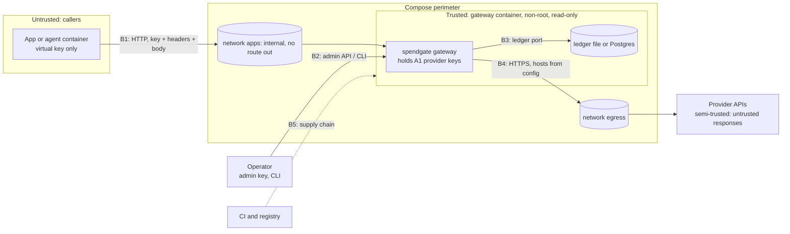

# spendgate threat model and security baseline

Status: proposed, 2026-11-13. Scope: v0.1, local only (SDK, local proxy, Docker Compose). Cloud patterns are on the [roadmap](../ROADMAP.md). Architecture: [architecture.md](./architecture.md). Fail-closed rule: [ADR-0003](adr/0003-fail-closed.md).

Security is tested where the control is built, not at the end. A test id with no test yet is listed as such at the end of section 5, never silently cited.

## 1. Assets

| ID | Asset | Why it matters | Where it lives |
|---|---|---|---|
| A1 | Provider keys | Direct spend on the operator's account | Gateway env or `file:/run/secrets/x` only |
| A2 | Budgets and limits | The product's promise: hard caps | Ledger (`budgets`, `scopes`) |
| A3 | Ledger integrity | Spent and held amounts must be true | Ledger (`reservations`, `calls`, `kill_switches`, `admin_audit`) |
| A4 | Prompts and responses in transit | May contain personal or confidential data | Memory of gateway only; never stored |
| A5 | Admin keys | Can mint keys, raise budgets, read usage | Hashed in ledger `keys`; shown once |
| A6 | Virtual keys | Spend authority inside a budget | Hashed in ledger `keys` |
| A7 | Price catalog | Wrong prices mean wrong charges | `catalog/prices.yaml` (in the image or mounted read-only) |
| A8 | Build and release chain | Compromise reaches every user and A1 | CI, dependencies, image |

## 2. Actors

| Actor | Capability assumed |
|---|---|
| Caller (legitimate app or agent) | Holds one virtual key; may be buggy or looping |
| Malicious caller or stolen key | Valid key, crafts headers and bodies, can send many requests |
| Network attacker on the Compose or host network | Can reach the gateway port, cannot read the host disk |
| Compromised app container | Runs arbitrary code, has a virtual key, no provider key |
| Malicious or compromised provider/upstream | Returns hostile bodies, usage numbers, SSE streams |
| Supply-chain attacker | Poisons a dependency, action or base image |
| Operator (trusted) | Holds admin key and host access; mistakes are in scope, malice is not |

## 3. Trust boundaries

| Boundary | Crosses | Rule |
|---|---|---|
| B1 caller to gateway | Key, headers, body | Nothing trusted; authenticate, size-check, then validate |
| B2 operator to gateway | Admin key | Scoped admin keys, optional separate port (optionally on its own network), audited |
| B3 gateway to ledger | SQL | Parameterised only; ledger down means refuse |
| B4 gateway to provider | Provider key, prompt | Hosts from config; responses are untrusted input |
| B5 build to runtime | Code, image | Pinned digests and SHAs; scanned; SBOM |
| B6 gateway to alert webhook (optional) | Budget facts, HMAC signature | URL from config only (a secret reference), `https` or loopback `http`, no redirects; allowlisted budget fields only; queued off the request path, so the receiver cannot delay or fail a call |

## 4. Threats (STRIDE-lite)

S spoofing, T tampering, R repudiation, I information disclosure, D denial of service, E elevation. Likelihood and impact are before controls (H/M/L). "Residual" is what remains.

| ID | Threat | STRIDE | L/I | Control | Test or note | Residual |
|---|---|---|---|---|---|---|
| TH-01 | Stolen or leaked virtual key used to spend | S, E | H/M | C-01 hashed keys, C-02 per-key scopes and limits, C-03 revoke and rotate without restart | T-AUTH-01, T-AUTH-02, T-AUTH-03, T-AUTH-05, T-KEY-01, T-LIM-01 | Spend up to that key's cap until revoked (bounded by C-02) |
| TH-02 | Admin API abuse (mint keys, raise budgets, read others' usage) | E | M/H | C-04 scoped admin keys, C-05 separate admin port option, C-06 admin audit log | T-ADM-01, T-ADM-02, T-ADM-03, T-ADM-06, T-ADM-07 | Operator holding `keys:write` is trusted to issue keys: it can still create a new key on any scope, so a key kill switch stops a credential, not a scope (a `scope` switch stops the scope) |
| TH-03 | Bypass: app calls the provider directly | E | H/H | C-07 provider keys only in the gateway, C-08 `apps` network internal, only the gateway on `egress` | T-NET-01, T-NET-02, T-NET-03 (negative test T-NET-04) | App holds its own leaked provider key: see section 6 |
| TH-04 | SSRF: URLs in request bodies (image_url, file URLs, audio) make the gateway or provider fetch internal hosts | T, I | M/H | C-09 upstream hosts from config only; URLs in request bodies are refused (images as `data:` only) unless `fail_open.allow_remote_media: true` (logged at start); gateway never fetches body URLs; no redirect following to new hosts | T-SSRF-01, T-SSRF-02 | With the opt-in, the provider fetches the URL itself (provider-side) |
| TH-05 | Memory exhaustion from large or many bodies | D | H/M | C-10 body-size and concurrency check before reading the body, streaming pass-through, per-key concurrency, container bounds on uploaded audio (EBML integers at most 8 bytes, duration at most 24 h) | T-DOS-01, T-DOS-02, T-DOS-03, T-AUD-01, T-AUD-02, T-AUD-03 | Slow-loris held connections: the key is checked before any byte is read, so unauthenticated callers hold no gate memory (SR-01, T-DOS-01). A keyed caller's body is read under a whole-body deadline and a minimum transfer rate (T-DOS-04, SR-02), is charged to the gate only for the bytes actually buffered, and one key can hold at most a quarter of the gate memory (NF-01). Residual: gate memory is `max(384 MiB, max_body_bytes x 3, max_json_body_bytes x 32)`, so raising `max_json_body_bytes` above about 12 MiB needs a container larger than 512 MiB; one event loop still serves every tenant |
| TH-06 | Ledger tampering (edit DB file, forge rows, SQL injection) | T | L/H | C-11 parameterised SQL only, C-12 ledger file mode 0600 and owned by the gateway user, no ledger mount in app containers, C-13 invariant checks and append-style `calls` | T-LED-01, T-LED-02, T-LED-03, T-MON-01, T-MON-02, T-MON-04 to T-MON-06 | Host root can edit the ledger: accepted (R-02) |
| TH-07 | Supply-chain compromise (dependency, action, base image, scanner) | T | M/H | C-14 pinned digests, SHAs, lockfile with hashes; C-15 pip-audit, image scan, SBOM; C-16 dependency budget (at most 6, 5 used); Dependabot | T-SUP-01 to T-SUP-06 | Zero-day in a pinned dependency |
| TH-08 | Log leakage (bodies, keys, headers, provider keys) | I | M/H | C-17 never log bodies or keys; redaction of `Authorization`, `x-api-key`; labels sanitised | T-LOG-01, T-LOG-02, T-LOG-03 | Operator adds debug logging: documented |
| TH-09 | Runaway agent session inside budget rules (loop burns the whole key budget) | D, E | H/M | C-18 session limits (max cost, calls, duration per `X-Spendgate-Session`), `session_required` keys that refuse calls without the header, `max_new_sessions_per_hour` (60 by default), per-key RPM/TPM and concurrency (16 by default), kill switch; sessions are per key and a session that hit a limit stays closed | T-SESS-01 to T-SESS-10 | Cost up to the session cap. Residual: on a key without `session_required`, session limits apply only to calls that send `X-Spendgate-Session`; a caller that omits the header is bounded by the key's parent budgets, RPM/TPM, concurrency and the kill switch alone. A key can also mint up to `max_new_sessions_per_hour` sessions an hour, so up to `max_new_sessions_per_hour` x session budget per hour, always inside the parent budgets; `null` removes that bound, and a key created before this default existed keeps the limits it was created with |
| TH-10 | Header spoofing of attribution (`X-Spendgate-User/Tags/Session`) to dodge or frame another user | S, R | H/M | C-19 attribution is a label, never authority: budgets and limits bind to the key's scope; user/session headers allowed only within the key's scope and charged to the key; values validated (charset, length, count) | T-ATTR-01, T-ATTR-02, T-ATTR-03 | A key holder can mislabel within its own scope: accepted (R-03) |
| TH-11 | Price catalog tampering or stale prices (undercharge) | T | M/H | C-20 catalog schema validation and checksum at load; unpriced means `model_not_priced`; catalog age shown on `/readyz` and metric, warn when older than configured days; read-only mount | T-CAT-01, T-CAT-02, T-CAT-03, T-CAT-05, T-MON-09 | Provider changes price between catalog updates: bounded by C-21 overrun metric |
| TH-12 | Malicious or compromised provider response (huge usage numbers, malformed SSE, endless stream) | T, D | L/M | C-22 usage sanity cap (flags the call with `review_required_at`, emits a metric and logs a warning; the reported usage is always booked, never clamped), SSE parser limits (line, event, total bytes), stream timeout, response size cap | T-PROV-01, T-PROV-02, T-PROV-03, T-ADP-01, T-ADP-02, T-ADP-03, T-ADP-04, T-ADP-05, T-ADP-06 | Honest-but-wrong provider usage is billed as reported; absurd values are flagged for review |
| TH-13 | Clock skew moves period boundaries (budget resets early or late) | T | L/M | C-23 all time from one injected application clock (UTC); stored timestamps come from that clock, not the database; backward jump never shortens a period; `/readyz` warns on skew against the database clock (Postgres `now()`) | T-CLK-01, T-CLK-02, T-CLK-03 | Host clock set maliciously by root: R-02 |
| TH-14 | Many holds without completion exhaust a budget (hold-flooding DoS) | D | M/M | C-24 hold expiry by lease (expired holds charged in full, so slow calls cannot cheat; a client cancel after the request was sent is charged in full unless usage was seen, so cancelling cannot dodge cost), per-key concurrency and RPM cap bound open holds, estimate capped by the model's max output | T-HOLD-01, T-HOLD-02, T-HOLD-03, T-MON-03, T-MON-11, T-MON-10 | A key holder can lock its own budget until expiry |
| TH-15 | Failure of a dependency opens the gate (ledger down, catalog missing, config error) | E | M/H | C-25 fail closed (ADR-0003): `ledger_unavailable`, `model_not_priced`, startup refuses a bad config, a missing FX rate or a missing output ceiling; fail-open only via the logged `fail_open:` config section | T-BLK-01 to T-BLK-06, T-MON-07 to T-MON-09 | None |
| TH-16 | Container escape or privilege abuse after gateway bug | E | L/H | C-26 non-root UID 10001, read-only root, `cap_drop: ALL`, `no-new-privileges`, memory and pids limits | T-CTR-01, T-CTR-02 | Kernel exploit: accepted (R-02) |
| TH-17 | Timing attack on key lookup | I | L/M | C-01 constant-time compare of hashes | T-AUTH-04 | None |
| TH-18 | Egress from the gateway to non-provider hosts (compromised gateway exfiltrates prompts) | I | L/H | Optional egress host allowlist is on the roadmap. v0.1 relies on C-09 and C-26 only | Accepted risk R-01 | See R-01 |
| TH-19 | Unauthenticated probes leak data (`/metrics`, `/readyz`, errors) | I | M/L | C-27 `/livez` minimal; `/readyz` on the data port answers with the status only, its details (reasons, warnings) and `/metrics` are bound to the admin port or an admin key with `usage:read`; labels carry no key secrets or prompt text; optional trace spans carry allowlisted attributes only; error bodies carry code only | T-OBS-01, T-OBS-02, T-OBS-03, T-OBS-04 | Metrics on the same port when no admin port is set: documented |
| TH-20 | Flood of well-formed fake keys loads the ledger (each distinct prefix is one lookup) | D | M/L | C-03 shape check before any I/O, short negative cache for a repeated unknown key, key checked before the body is read and before any gate place (C-10, SR-01) | T-AUTH-05, T-AUTH-06 | One indexed ledger read per distinct fake key, nothing else; no per-peer throttle: accepted risk R-06 |
| TH-21 | A request understates its own billable size: an uploaded audio file whose container header declares a shorter duration than the audio it holds, so the hold is a fraction of what the provider bills | T, E | H/H | C-10 the duration is counted from what a decoder decodes (packets, frames, sample tables, PCM bytes), a declared length can only raise it, and a file with more audio bytes than its counted length can carry is refused (ADR-0029, M-16); C-21 overrun metric | T-AUD-04 | Assumed: the provider decodes the file as a standard demuxer and decoder do and bills one audio track (several are added up). A decoder that found audio the count misses would overrun the hold; the overrun is booked in full (M-03) and blocks the budget under `strict_overrun` (M-07) |
| TH-22 | One key takes a shared deployment away from every other key: it provokes provider 4xx answers (a chat model sent to `/v1/embeddings` draws an unbilled 403) until the deployment's circuit breaker opens, and every tenant routed to it gets `503 upstream_unavailable` for the cooldown | D | H/M | C-28 a model is sent only to endpoints of its catalog mode; the breaker counts a 403 or 404 only when the provider's code says our key or deployment is wrong (ADR-0033) | T-DOS-05, T-DOS-06 | A caller can still provoke 5xx answers with chosen bodies; each such call is charged to that caller in full (M-13). A misconfiguration reported as a 403 or 404 without a code the adapter reads does not open the breaker: its calls fail at once, charged 0 |

Count: 20 threats.

## 5. Controls and proof

Each control maps to at least one test or CI check. Test ids are stable; "Where" names the files that carry them (`tests/unit/test_threat_model.py` fails when a named file does not exist).

| Control | Description | Test id | Where |
|---|---|---|---|
| C-01 | Keys stored as prefix + HMAC-SHA256(server pepper, secret); constant-time compare (`hmac.compare_digest`); pepper from `env:`/`file:` | T-AUTH-01 no plaintext secret in DB or logs; T-AUTH-04 compare is constant-time (uses `hmac.compare_digest`, checked by test and ruff `S`) | `tests/contract/test_keys.py` |
| C-02 | Per-key scope, model allowlist, budgets, RPM/TPM/concurrency | T-AUTH-02 key cannot use a model or scope it is not allowed; T-LIM-01 limits enforced per key; T-KEY-01 an empty `allowed_models` is refused, never read as "every model" | `tests/integration/test_gateway_refusals.py` (T-AUTH-02, T-LIM-01), `tests/contract/test_keys.py` (T-KEY-01) |
| C-03 | Revoke and rotate without restart; revoked key refused within cache TTL; rotation grace period; a key is shape-checked before any I/O and checked before the body is read | T-AUTH-03; T-AUTH-05 a repeated unknown key costs one ledger read per short window, not one per request; T-AUTH-06 a flood of distinct unknown keys costs one indexed ledger read each and nothing else (no body read, no gate place, no hold, no upstream contact) | `tests/contract/test_keys.py`, `tests/integration/test_unknown_key_flood.py` (T-AUTH-06) |
| C-04 | Admin keys with scopes `usage:read`, `keys:write`, `budgets:write`; a virtual key never works on `/admin/v1`; `keys:write` cannot grant spend room: a session budget alone is no budget (M-17), setting or raising a session budget or loosening `max_new_sessions_per_hour` also needs `budgets:write`, and a key kill switch survives rotation (M-18) ([ADR-0030](adr/0030-session-budgets-only-narrow.md)) | T-ADM-01 each scope allows only its routes; T-ADM-02 virtual key refused on admin; T-ADM-06 `keys:write` alone cannot set or raise session budgets; T-ADM-07 rotation keeps the kill switch | `tests/integration/test_admin.py`, `tests/integration/test_admin_spend_room.py` |
| C-05 | Admin API optionally on a separate port; Compose does not publish it to apps: it listens on loopback in the guard's container, or with `compose.admin.yaml` on an internal `admin` network only the operator service joins ([ADR-0027](adr/0027-admin-network.md)) | T-ADM-03 admin port unreachable from the app network, by name or by address, on loopback and on the `admin` network, while the operator on `admin` reaches it | `tests/perimeter/test_perimeter.py`, `tests/perimeter/test_admin_network.py` |
| C-06 | Every admin write recorded in `admin_audit` (actor key prefix, action, time, request id, before/after, no secrets); the table is append-only, enforced by triggers (UPDATE and DELETE abort); no hash chain, so root on the host can still rewrite it (R-02) | T-ADM-04 audit row per write; no secrets in row; T-ADM-05 UPDATE and DELETE on `admin_audit` are rejected | `tests/contract/test_keys.py` (T-ADM-04), `tests/contract/test_sqlite_adapter.py` (T-ADM-05) |
| C-07 | Provider keys exist only in the gateway container | T-NET-01 no other container has an env var or secret matching any configured provider credential name (all providers); T-NET-04 deliberately leaked key makes T-NET-01 fail | `tests/perimeter/test_perimeter.py` |
| C-08 | `apps` network `internal: true`; only gateway also joins `egress` | T-NET-02 app cannot reach the internet; T-NET-03 app can reach the gateway | `tests/perimeter/test_perimeter.py` |
| C-09 | Upstream hosts only from `spendgate.yaml`; body URLs refused (`data:` only) unless the logged opt-in; never fetched by the gateway; redirects to unconfigured hosts refused | T-SSRF-01 body with an internal or remote URL is refused (`invalid_request`, zero upstream contact) in every nested content position (chat parts, Responses content and `function_call_output.output`, Anthropic image and `tool_result` blocks; `input_file` always), `data:` URLs pass, and the opt-in `fail_open.allow_remote_media` is logged at start; T-SSRF-02 redirect to another host is not followed | `tests/contract/providers/test_ssrf_nested.py`, `tests/integration/test_upstream_redirects.py` (T-SSRF-02) |
| C-10 | Size and concurrency checked before the body is read; streaming of large bodies; uploaded audio measured by counting what a decoder decodes, within bounded parse work (ADR-0029) | T-DOS-01 oversize `Content-Length` gives `request_too_large` with zero bytes read; T-DOS-02 16 parallel 25 MB uploads stay under memory limit; T-DOS-03 chunked body over limit aborted; T-DOS-04 slow client times out; T-AUD-01 a WebM with a several-MiB TimecodeScale is rejected in under 50 ms; T-AUD-02 EBML integers longer than 8 bytes are rejected; T-AUD-03 a measured duration over 24 h is rejected in every container; T-AUD-04 a header that understates the audio never lowers the measured duration in any container (FLAC, MP4, Ogg, WAV, WebM, MP3), and audio larger than its counted length can carry is refused (M-16) | `tests/integration/test_gateway_refusals.py`, `tests/integration/test_intake_memory.py` (T-DOS-01, T-DOS-03), `tests/integration/test_gateway_memory.py` (T-DOS-02), `tests/integration/test_intake_stalls.py` (T-DOS-04), `tests/unit/test_audio.py`, `tests/unit/test_audio_counted.py` (T-AUD-04) |
| C-11 | Parameterised SQL only; no string-built queries | T-LED-01 injection strings in labels, ids, keys leave the schema intact; ruff `S608` in CI | `tests/contract/test_ledger_sessions.py` |
| C-12 | Ledger file mode 0600, gateway-owned; not mounted into app containers | T-LED-02 mode check on startup and in Compose test | `tests/contract/test_sqlite_adapter.py` |
| C-13 | Ledger invariants: `spent + held <= effective_cap + overrun + excess` (effective cap includes active grants); state machine forbids illegal transitions; `calls` append-only except the sweeper-row update on late settle | T-LED-03 stateful property test and multi-process test; T-MON-01 release-then-retry; T-MON-02 fallback within one reservation; T-MON-04 grant add and expiry; T-MON-05 overrun inside cap does not block; T-MON-06 cap lowered then raised | `tests/contract/test_ledger.py`, `tests/unit/test_budgets.py` (T-MON-04), `tests/contract/test_ledger_multiprocess.py` (T-LED-03) |
| C-14 | Actions pinned by commit SHA, base image by digest, uv pinned, lockfile with hashes | T-SUP-01 a test rejects `uses:` references that are not a full commit SHA and `FROM` lines or service images without a digest; T-SUP-02 `uv lock --check` runs in the lint job | `tests/unit/test_pins.py`, `.github/workflows/ci.yml` (lint job) |
| C-15 | pip-audit, secret scan, image scan (pinned), SBOM, Dependabot | T-SUP-03 pip-audit; T-SUP-04 image scan; T-SUP-05 detect-secrets | CI jobs |
| C-16 | Base install limited to six dependencies (five used) | T-SUP-06 test counts base dependencies from `pyproject.toml` | `tests/unit/test_dependencies.py` |
| C-17 | Logging allowlist of fields; bodies and key material never logged; `Authorization` and `x-api-key` redacted | T-LOG-01 run scripted calls with a marker prompt and a marker key, grep logs; T-LOG-02 grep DB; T-LOG-03 error bodies contain no key; T-LOG-04 `serve` never prints or creates bootstrap key secrets; `migrate --bootstrap` hands each new secret over once, printed only when stderr is a terminal or written to a new 0600 `--secrets-file` (never over an existing file), and without either refuses before writing any row when it would create a key ([ADR-0032](adr/0032-bootstrap-secrets-file.md)); T-LOG-05 `serve` writes no HTTP access log (it recorded query strings) and leaves the handlers spendgate attached open | `tests/unit/test_observability.py` (T-LOG-01), `tests/integration/test_logging.py` (T-LOG-02, T-LOG-03), `tests/integration/test_admin_bootstrap.py`, `tests/integration/test_bootstrap_secrets.py` (T-LOG-04), `tests/integration/test_serve_shutdown.py` (T-LOG-05) |
| C-18 | Session limits (cost, calls, duration), kill switch per scope | T-SESS-01 `session_limit_reached` at the cap; T-SESS-02 40 parallel loops on one key stop at the cap (SQLite and Postgres): spend never above it, nothing left held, every refusal `budget_exhausted`, no refused call reaches the upstream; T-SESS-03 a kill switch engaged mid-loop refuses the next call (`kill_switch`) and stops a stream still open at the next heartbeat, charged the full hold; T-SESS-04 idle expiry restarts the session; T-SESS-05 `max_new_sessions_per_hour` refuses; T-SESS-06 session header refused (`invalid_request`) on a key without `session_defaults`; T-SESS-07 a session that hit a limit keeps returning `session_limit_reached` for the same id, and two keys on one scope never share a session; T-SESS-08 a `session_required` key refuses a call without the header, or with an empty, blank or padded one (`invalid_request`), before any hold, and a repeated header runs in the session its last value names; T-SESS-09 a key's `session_defaults` get `max_new_sessions_per_hour: 60` unless it is set | `tests/integration/test_sessions.py` (T-SESS-02, T-SESS-03), `tests/integration/test_gateway_refusals.py` (T-SESS-01, T-SESS-06, T-SESS-08), `tests/contract/test_ledger_sessions.py` (T-SESS-04, T-SESS-05, T-SESS-07), `tests/integration/test_admin_bootstrap.py` (T-SESS-09) |
| C-19 | Attribution headers validated and subordinate to the key's scope | T-ATTR-01 header cannot move spend to another key's budget; T-ATTR-02 control characters, long values, too many tags rejected; T-ATTR-03 label injection in logs and metrics blocked | `tests/integration/test_attribution.py` |
| C-20 | Catalog validated against `catalog/schema.json` at load; unpriced model refused; age reported | T-CAT-01 invalid catalog stops startup; T-CAT-02 unpriced gives `model_not_priced` with zero upstream calls; T-CAT-03 a catalog older than 30 days (`STALE_CATALOG_DAYS` in `gateway/observability.py`; a constant, not yet a config key) raises a warning on the admin readiness detail, and the age and sha metrics are set at start and refreshed at every scrape; T-CAT-05 every `calls` row records `catalog_sha` and `price_id`; T-MON-09 catalog fail-open knobs (`charge_zero`, `free_statuses` outside 429/529) rejected at load | `tests/unit/test_catalog.py`, `tests/integration/test_admin_readiness.py`, `tests/integration/test_gateway_refusals.py` (T-CAT-02) |
| C-21 | Overrun tracked and exposed (`spendgate_overruns_total`) | T-CAT-04 metric moves when the provider reports more than the hold | `tests/integration/test_overrun_metric.py` |
| C-22 | Usage sanity flag (never a clamp), SSE parser limits, stream and response size caps | T-PROV-01 absurd usage is booked as reported and flagged (`review_required_at`, metric, warning), never clamped; T-PROV-02 malformed SSE does not crash and is settled at the hold; T-PROV-03 endless stream cut at limit; T-ADP-01 to T-ADP-06 every adapter's `usage`, `error`, `response` and stream collector never raise on hostile bodies or headers (deep nesting, huge numbers, non-ASCII `Retry-After`): unreadable means usage None (the hold is charged) or a mapped error, and counters that do not fit int64 are unreadable; fuzz in 8.2 | `tests/contract/providers/test_hostile_input.py`, `tests/contract/providers/test_retry_after.py` |
| C-23 | One injected application clock; UTC periods; timestamps from the app clock; monotonic for durations; skew warning vs database clock | T-CLK-01 clock jumps back and forward across a period boundary; T-CLK-02 period roll at exact boundary; T-CLK-03 skew between app clock and database clock raises the `/readyz` warning | `tests/contract/test_ledger.py` (T-CLK-01), `tests/unit/test_budgets.py` (T-CLK-02), `tests/unit/test_observability.py`, `tests/integration/test_admin_reports.py` (T-CLK-03) |
| C-24 | Lease expiry; expired holds charged in full; open holds bounded by concurrency | T-HOLD-01 abandoned holds expire and are charged; T-HOLD-02 crash mid-call, another instance recovers; T-HOLD-03 flood of holds from one key is capped by concurrency; T-MON-03 late settle after expiry with charge > hold books the difference as overrun; T-MON-10 owner-versus-sweeper race on one hold (one winner, no double charge); T-MON-11 client cancel after send is charged the full hold unless usage was seen, and free only if never sent; T-LIB-01 library mode keeps a stream longer than one lease alive through the pipeline heartbeat | `tests/contract/test_ledger_leases.py`, `tests/integration/test_maintenance.py` (T-HOLD-01), `tests/integration/test_hold_flood.py` (T-HOLD-03), `tests/integration/test_gateway_cancel.py` (T-MON-11), `tests/integration/test_local_stream_leases.py` (T-LIB-01) |
| C-25 | Fail closed on every uncertain state | T-BLK-01 unpriced; T-BLK-02 budget; T-BLK-03 kill switch; T-BLK-04 bad key; T-BLK-05 too large; T-BLK-06 ledger down (no upstream contact). Each gives zero upstream requests; T-MON-07 missing FX and T-MON-08 missing output ceiling are refused at start or request; T-LIB-02 library mode logs every fail-open option at start | `tests/perimeter/test_block.py`, `tests/integration/test_gateway_refusals.py` (T-BLK-06), `tests/contract/test_ledger_sessions.py` (T-BLK-03), `tests/unit/test_catalog.py` (T-MON-07, T-MON-08), `tests/contract/providers/test_output_ceiling.py` (T-MON-08), `tests/integration/test_local_stream_leases.py` (T-LIB-02) |
| C-26 | Non-root, read-only, no capabilities, resource limits | T-CTR-01 `docker run <image> id` is UID 10001; T-CTR-02 container started with read-only root and `cap_drop: ALL`, writes outside the data volume fail | `tests/perimeter/test_container.py` |
| C-27 | Minimal probes; sensitive endpoints behind admin scope; no secrets in metric labels | T-OBS-01 unauthenticated `/metrics` refused when an admin port or key is configured; T-OBS-02 labels contain no key secret or prompt text; T-OBS-03 the data-port `/readyz` returns the status code and `{"status"}` only, details need `usage:read` on `/admin/v1/readiness`; T-OBS-04 optional trace spans carry allowlisted attributes only (no prompt, key, user, tag or session value, no exception message) and only `traceparent` reaches the provider | `tests/integration/test_admin_readiness.py`, `tests/integration/test_admin_reports.py`, `tests/integration/test_otel_tracing.py` |
| C-28 | Endpoint and catalog mode must match before routing (`core.modes.serves`); the shared circuit breaker counts only answers that fail for every caller: 5xx, 408, 401, and a provider code each adapter reads as a deployment fault (`UpstreamError.deployment_fault`, ADR-0033) | T-DOS-05 403 and 404 answers caused by one key do not refuse another key's calls, while an invalid provider key or a missing model still opens the breaker; T-DOS-06 a model on an endpoint of another mode (a chat alias on `/v1/embeddings`) is refused `invalid_request` with zero upstream requests | `tests/integration/test_breaker_caller_errors.py` (T-DOS-05), `tests/integration/test_endpoint_mode.py`, `tests/unit/test_modes.py` (T-DOS-06) |

Count: 28 controls, 99 distinct test ids.

### Test ids with no test yet

`tests/unit/test_threat_model.py` fails when a test id cited in a table above is neither carried by a test (in its name, docstring or a `# T-XX-NN` comment, anywhere under `tests/`) nor listed here. An id listed here is honest about the gap: the control may exist, but no automated test is tagged with it.

- Planned (the control exists or is being built; the test does not carry the id yet): none. The last 19 were written or tagged for review finding SR-10. T-ADM-03, T-CTR-01 and T-CTR-02 are Docker tests (`pytest -m docker tests/perimeter`), so they run only where Docker does.
- CI job (the check is a CI step, not a test): T-SUP-03 (`make audit`, pip-audit), T-SUP-04 (Trivy image scan), T-SUP-05 (`make secrets`, detect-secrets)

## 6. What spendgate does NOT protect against

| Out of scope | Why | Mitigation outside spendgate |
|---|---|---|
| Library mode is cooperative | Code in the same process can skip the SDK and call the provider; the key is in that process | Use proxy mode with the perimeter for anything untrusted |
| A provider key leaked elsewhere (laptop, notebook, another service) | The provider honours the key regardless of spendgate | Rotate at the provider; use provider-side budgets and alerts; give each system its own key |
| Prompt injection and jailbreaks | Content is forwarded; spendgate does not read or judge it | Application-level defences; spendgate only limits the cost |
| Data residency and provider retention | Prompts leave to the chosen provider | Choose regions and contracts per deployment; spendgate does not store prompts |
| Host root or a malicious operator | They can read keys and edit the ledger | OS access control, disk encryption, backups |
| Provider billing differences | Spendgate estimates from the catalog and reported usage; the invoice is the truth | Reconcile monthly against provider invoices (see how-money-is-protected) |
| Network attackers on the host's published port | v0.1 has no TLS termination | Bind to localhost or the Compose network; TLS is a deployment concern |
| Denial of service by volume from the network | Single small process | Put behind a reverse proxy if exposed; out of v0.1 scope |
| Side effects from tool calls in agent runs | Spendgate sees LLM spend, not what the agent does | Agent sandboxing |

## 7. Accepted risks

| ID | Risk | Rationale | Revisit when |
|---|---|---|---|
| R-01 | No egress host allowlist: a compromised gateway could reach any internet host | Gateway code is small and audited; hosts come from config; the Compose network already stops apps; an allowlist needs a forward proxy or nftables, which adds moving parts to a "local first" v0.1 | Hosting beyond one trusted machine, or any `egress` change |
| R-02 | Host root can read keys, edit the ledger, set the clock | Host compromise defeats any single-host tool | A multi-tenant deployment is planned |
| R-03 | A key holder may mislabel user, tags or session within its own scope | Labels are for reporting; money is bound to the key; policy never trusts labels | Per-end-user billing with untrusted callers is needed |
| R-04 | Honest-but-wrong provider usage is billed as reported (C-22 flags absurd values, never clamps) | There is no independent source of truth | Reconciliation against invoices shows drift |
| R-05 | A key holder can lock its own budget with open holds until lease expiry | Bounded by concurrency and lease length; for money it harms only that key's scopes. The process is shared, though: input that costs a lot of CPU or memory can slow every tenant. Found and fixed or bounded in v0.1 review: uploaded audio containers (SR-03, T-AUD-01 to T-AUD-03). Fixed in v0.1: unauthenticated large or stalled bodies (SR-01, SR-02, T-DOS-01, T-DOS-03, T-DOS-04), and one key filling the shared body gate (NF-01); a Matroska file is capped at one million elements (NF-05). One event loop remains a single point of slowdown for any caller (section 6, volume) | Sessions with a very long lease are added, or a multi-tenant deployment is planned |
| R-06 | No per-peer throttle on failed authentication: a flood of distinct well-formed fake keys costs one ledger read each (SR-11) | The cost is bounded and pinned by T-AUTH-06: one indexed read by prefix, no body read, no gate place, no hold, no write, no upstream contact; guessing a key is hopeless (192-bit secret, constant-time compare). The gateway cannot tell callers apart reliably: behind a reverse proxy, NAT or the Compose network many callers share one peer address, so a per-peer lockout would let one noisy caller refuse every other caller behind it, turning load into a cross-tenant denial of service. Doing it right needs trusted-proxy configuration and a new refusal; volume from the network is already out of scope (section 6) and belongs to a reverse proxy that knows real client addresses | The data port is exposed beyond a trusted network, or failed-key reads show up in load reports |

## 8. Process

- Every new endpoint, provider or config option adds or updates a row here in the same PR.
- A CI check (`tests/unit/test_threat_model.py`) parses this file and fails if a threat row lacks a control id and a test id or an `R-` note, or if a cited test id has no test carrying it and is not listed under "Test ids with no test yet".
- The file is reviewed against the code with the OWASP API Top 10 as a cross-check.
